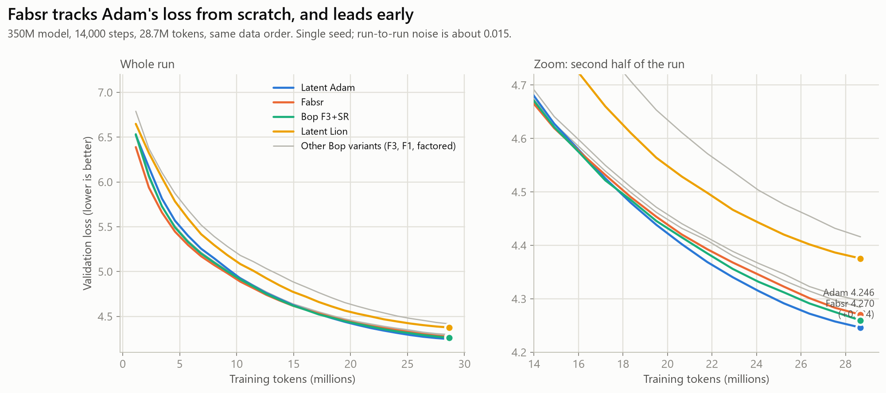
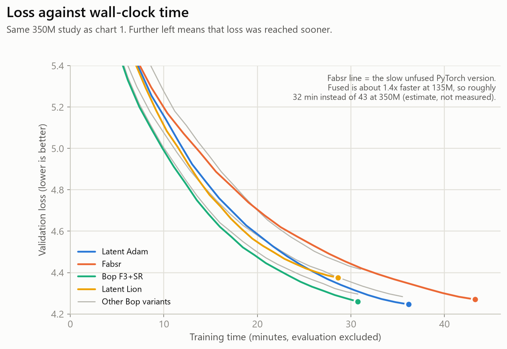
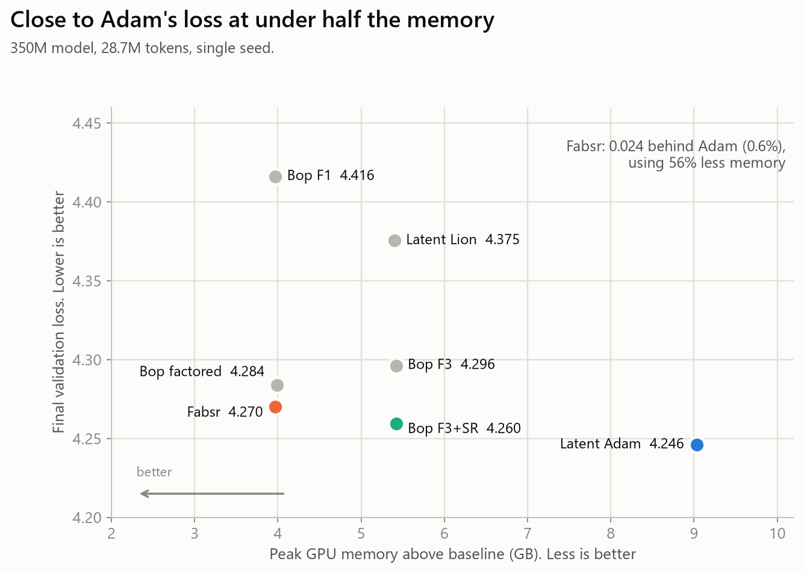
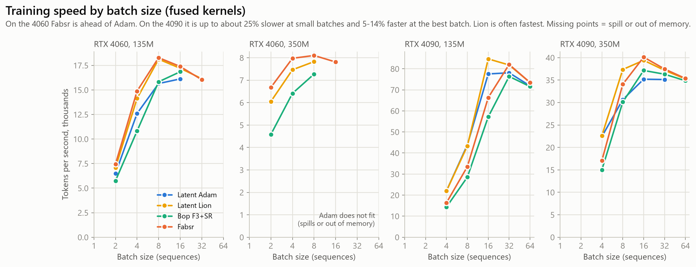
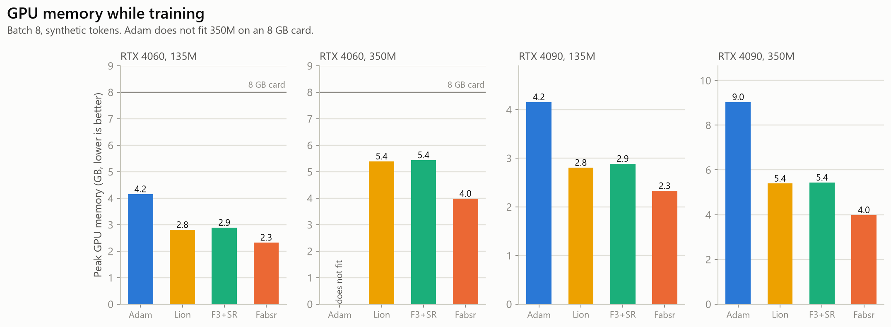
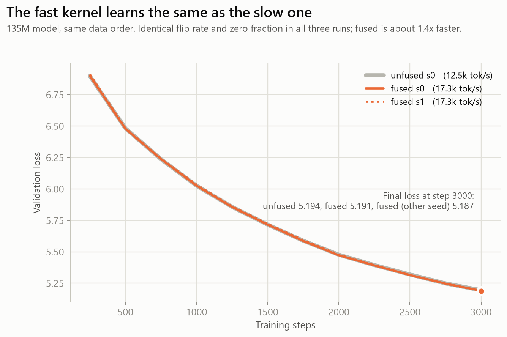
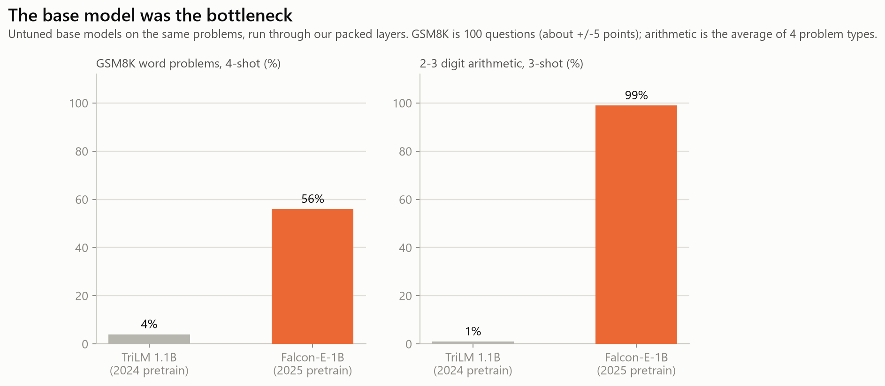
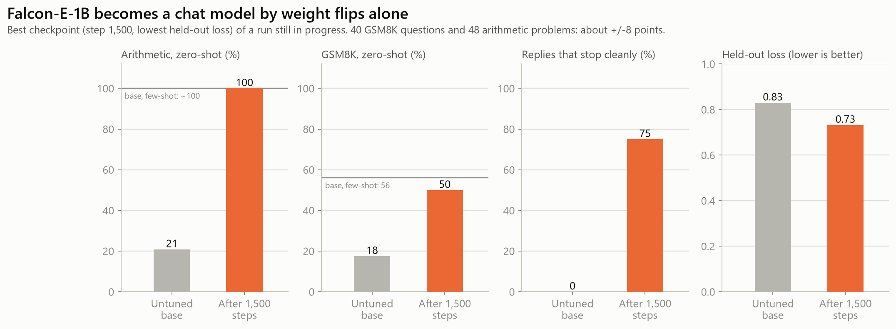
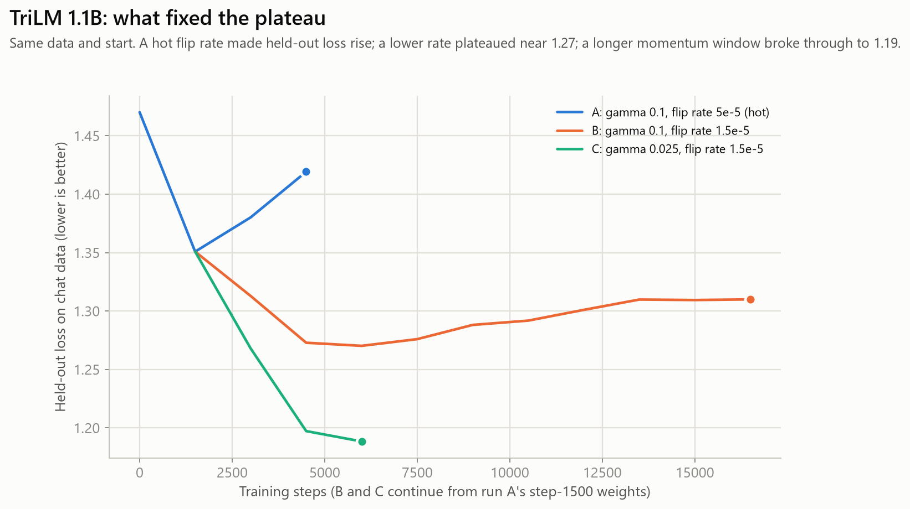

# Fabsr: teaser results

Results so far for **Fabsr**, a weight-flip optimizer that trains ternary (-1/0/+1) language models stored as 2-bit codes, with no full-precision copy of those weights.

**This repo is results only.** The optimizer code and model weights are not published yet; write-up and code to follow.

## At a glance

- **From scratch (350M model):** loss within 0.024 of Adam's (about 0.6%) using 56% less GPU memory. Single seed at toy scale (28.7M tokens); run-to-run noise is about 0.015.
- **Speed:** depends on batch size. Roughly on par with Adam: ahead on an 8 GB card and at the best batch size, up to about 25% slower at small batches on a 4090. Adam does not fit the 350M model on an 8 GB card at all.
- **Fine-tuning a real model:** TII's Falcon-E-1B (a natively ternary base model) became a chat model that does arithmetic, using only weight flips on an 8 GB gaming GPU (about 5 GB used): zero-shot arithmetic 21% to 100%, GSM8K 18% to 50% (small samples), after 1,500 steps of a run still in progress.
- **No Adam or LoRA baseline for the fine-tuning results yet.** Claims here are 'it works and it is small', not 'it beats Adam'.

## How the optimizer works

1. Each trainable weight is -1, 0 or +1, stored as a 2-bit code (4 weights per byte). There is no full-precision copy of these weights.
2. Forward and backward run as normal. In backward, each matrix computes its dense weight gradient and hands it to the optimizer, then drops it.
3. The optimizer keeps a bf16 momentum (an exponential average of the gradient, with stochastic rounding) and a factored second-moment estimate (one vector per row and per column).
4. Every few steps it computes a signal score per weight (momentum divided by the noise estimate) and picks a threshold so that only a small fraction of weights (the 'flip rate', about 1e-5 per step) is flipped.
5. Weights above the threshold move one level toward the signal (-1 -> 0 -> +1) and their momentum resets. Everything else stays untouched. Embeddings, norms and the output head are frozen.

## Study A: 350M model trained from scratch (quality)

350M model, 14,000 steps, 28.7M tokens, same data order and schedule, single seed. Run-to-run noise about 0.015. Fabsr row is the unfused PyTorch version.

| Method | Final val loss | Peak memory | Tokens/s (measured) | Minutes (measured) | Kernel in this run | Rough estimate with the fused kernel |
|---|---|---|---|---|---|---|
| Latent Adam | 4.2462 | 9.03 GB | 13213 | 36.2 | not re-checked |  |
| Bop F3 | 4.2962 | 5.42 GB | 15545 | 30.7 | not re-checked |  |
| Bop F3+SR | 4.2596 | 5.42 GB | 15546 | 30.7 | not re-checked |  |
| Bop F1 | 4.416 | 3.97 GB | 15401 | 31.0 | not re-checked |  |
| Bop factored | 4.2838 | 3.99 GB | 13458 | 35.5 | unfused PyTorch hook | not estimated |
| Fabsr | 4.2703 | 3.97 GB | 11045 | 43.3 | unfused PyTorch hook | about 15k tok/s, about 31 min (estimate: 11.0k x 1.39, the fused/unfused ratio measured at 135M) |
| Latent Lion | 4.3755 | 5.40 GB | 16719 | 28.6 | not re-checked |  |

**Corrections and disclaimers for this table**

- The speed correction is an estimate, not a measurement: the 1.39x ratio came from a 135M model and may not transfer exactly to 350M.
- Fusing the kernel did not change the loss at 135M (5.1907 fused vs 5.1943 unfused after 3,000 steps), but no full 350M quality run has been repeated with the fused kernel.
- The quality study and the speed benchmark ran on different machines, so the corrected speed is a bridge between two experiments, not one clean run.
- Loss values are single-seed with about 0.015 run-to-run noise.

## Study B: speed and memory at batch 8 (fused kernels)

**RTX 4060 8 GB, 135M**

| Method | Tokens/s | Peak GB | Optimizer state GB |
|---|---|---|---|
| Latent Adam | 15,652 | 4.15 | 1.08 |
| Latent Lion | 18,131 | 2.8 | 0.27 |
| Bop F3+SR | 15,830 | 2.88 | 0.81 |
| Fabsr | 18,288 | 2.32 | 0.27 |

**RTX 4060 8 GB, 350M**

| Method | Tokens/s | Peak GB | Optimizer state GB |
|---|---|---|---|
| Latent Adam | does not fit (spill or out of memory) |  |  |
| Latent Lion | 7,829 | 5.39 | 0.71 |
| Bop F3+SR | 7,273 | 5.43 | 2.12 |
| Fabsr | 8,104 | 3.98 | 0.71 |

**RTX 4090 24 GB, 135M**

| Method | Tokens/s | Peak GB | Optimizer state GB |
|---|---|---|---|
| Latent Adam | 43,882 | 4.15 | 1.08 |
| Latent Lion | 43,326 | 2.8 | 0.27 |
| Bop F3+SR | 28,552 | 2.88 | 0.81 |
| Fabsr | 33,535 | 2.33 | 0.27 |

**RTX 4090 24 GB, 350M**

| Method | Tokens/s | Peak GB | Optimizer state GB |
|---|---|---|---|
| Latent Adam | 30,639 | 9.03 | 2.83 |
| Latent Lion | 37,362 | 5.39 | 0.71 |
| Bop F3+SR | 30,109 | 5.43 | 2.12 |
| Fabsr | 34,070 | 3.98 | 0.71 |

## Study C: fused vs unfused kernel (135M, 3000 steps)

| Run | Final val loss | Tokens/s | Flips per weight per step | Zero fraction |
|---|---|---|---|---|
| unfused s0 | 5.1943 | 12,476 | 5.39e-05 | 0.329 |
| fused s0 | 5.1907 | 17,332 | 5.39e-05 | 0.329 |
| fused s1 | 5.1873 | 17,257 | 5.39e-05 | 0.329 |

## LLM results

**Untuned base models, same problems**

| Base model | GSM8K 4-shot % | Arithmetic 3-shot % | Wikitext-2 loss |
|---|---|---|---|
| TriLM 1.1B (2024 pretrain, 0.97B ternary weights) | 4 | {'add2': 4, 'sub2': 0, 'mul': 0, 'add3': 0} | 3.311 |
| Falcon-E-1B (2025 pretrain, 1.59B ternary weights) | 56 | {'add2': 100, 'sub2': 96, 'mul': 100, 'add3': 100} | 2.843 |

**Falcon-E-1B instruct tuning (flips only)**

| Step | Held-out loss | Stops | Loops | Wikitext | GSM8K 0-shot | Arithmetic 0-shot |
|---|---|---|---|---|---|---|
| 0 | 0.83 | 0% | 21% | 2.843 | 17% | 21% |
| 1500 | 0.732 | 75% | 0% | 2.618 | 50% | 100% |

Selected checkpoint: step 1500 (best held-out loss). The run is in progress; later evals at a still-high flip rate were lower on arithmetic and GSM8K.

**TriLM 1.1B runs (held-out loss by step)**

- A: gamma 0.1, flip rate 5e-5 (hot): 0: 1.47, 1500: 1.351, 3000: 1.38, 4500: 1.419
- B: gamma 0.1, flip rate 1.5e-5: 0: 1.351, 1500: 1.313, 3000: 1.273, 4500: 1.27, 6000: 1.276, 7500: 1.288, 9000: 1.292, 10500: 1.301, 12000: 1.31, 13500: 1.309, 15000: 1.31
- C: gamma 0.025, flip rate 1.5e-5: 0: 1.351, 1500: 1.268, 3000: 1.197, 4500: 1.188

## Training speed and VRAM on the RTX 4060 (8 GB)

| Model | Seconds per step | Peak VRAM (GB) | Packed weights (GB) | Momentum (GB, bf16) | Tokens per batch |
|---|---|---|---|---|---|
| TriLM 1.1B (0.97B ternary weights) | 0.75 to 1.1 | 4.7 to 5.55 | 0.24 | 1.94 | about 2,300 |
| Falcon-E-1B (1.59B ternary weights) | 1.45 to 1.75 (eval time included) | 5.0 to 5.68 | 0.4 | 3.2 | about 1,800 |

## What we did, in order

1. Built the packed 2-bit ternary layer and fused flip kernels; tested against the dense version (same flips with the same seeds).
2. TriLM 1.1B: taught it invented facts (it absorbed them), then instruct-tuned it (Alpaca, SlimOrca, then SmolTalk); tried DPO (collapsed at a hot rate, then fine at a low one).
3. Found the three fixes on TriLM: real chat data, a lower flip rate, and a longer momentum window (held-out loss 1.47 -> 1.19).
4. Found the base model could not do math (GSM8K 4%), so switched to Falcon-E-1B (native ternary, 2025 pretrain): GSM8K 56%, arithmetic ~100%.
5. Loaded Falcon-E into our packed layers (verified the packing against its bf16 latents) and instruct-tuned it with flips only: arithmetic 21% -> 100%, GSM8K 18% -> 50% zero-shot at step 1500.

## Caveats

- Study A is single-seed at toy scale (28.7M tokens); Fabsr ends 0.024 behind Adam and the noise is about 0.015.
- Study A's Fabsr row is the unfused version; fused speed and the loss were measured in separate experiments (study B and C).
- No Adam or LoRA baseline exists yet for the LLM fine-tuning results.
- Speed depends on batch size. At each method's best batch Fabsr is about 13% faster than Adam (4060, 135M; 4090, 350M); at batch 8 on the 4090 with the 135M model Adam is clearly faster (43.9k vs 33.5k tok/s). Lion is often the fastest. The memory advantage holds at every batch size.
- Falcon-E evals are small (40 GSM8K questions, 48 arithmetic problems, about +/-8 points).
- A fresh equal benchmark (WikiText-103, 4 methods x 3 seeds on rented 4090s) is planned but not run.

## Raw data

Everything above is also in [`fabsr_results.json`](fabsr_results.json).

Base model credit: Falcon-E-1B-Base by TII (Technology Innovation Institute). Not affiliated.
